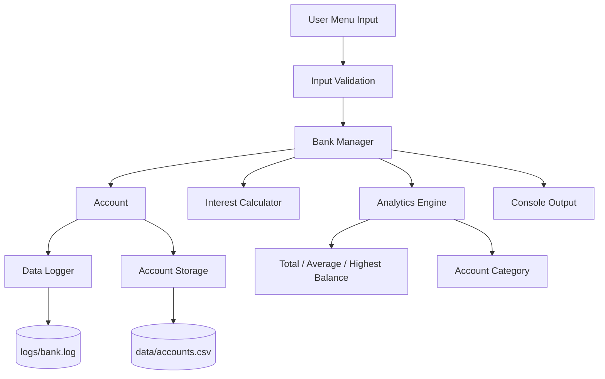
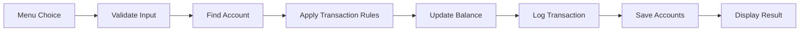

# Bank Account Management System

## Project Overview

The **Bank Account Management System** is a Linux-based C++11 command-line application that simulates the core operations of a retail bank.

The system lets a user create accounts, deposit and withdraw money, transfer funds between accounts, check balances, estimate interest, and view bank-wide analytics. Every transaction is validated, written to a transaction log, and the account data is saved to a file so it persists between runs.

---

## Objectives

- Simulate basic banking operations in software.
- Process transactions using a modular C++ design.
- Enforce banking rules (minimum balance, valid amounts, valid names).
- Transfer money safely between two accounts.
- Estimate interest on an account balance.
- Classify accounts into balance categories.
- Store transactions in a log file and accounts in a data file.
- Demonstrate Linux, C++ and Git-based development.

---

## System Architecture



---

## Data Flow



---

## Main Features

- Account creation with automatic account numbers (starting at 1001).
- Deposit, withdrawal and fund transfer.
- Minimum balance rule (Rs. 500 must always remain).
- Balance enquiry with account category.
- Simple-interest estimate.
- Bank-wide analytics (total, average and highest balance).
- Input validation for names, amounts, account numbers and menu choices.
- Timestamped transaction logging.
- Persistent account storage.
- Modular C++11 implementation.
- Unit testing for every module.
- Bash build and test scripts.

---

## Calculations and Rules

### Simple Interest

The project uses an assumed interest rate of **4.00 % per year**.

```text
Interest = (Balance × Rate × Years) / 100
Maturity Amount = Balance + Interest
```

### Minimum Balance

```text
Balance after withdrawal must be ≥ Rs. 500
```

### Account Category

```text
Below Rs. 5,000            → BASIC
Rs. 5,000 – Rs. 1,00,000   → STANDARD
Above Rs. 1,00,000         → PREMIUM
```

### Transfer

```text
Source Balance      = Source Balance − Amount   (minimum balance rule applies)
Destination Balance = Destination Balance + Amount
```

---

## Project Structure

```text
bank-account-management-system/
│
├── include/
│   ├── account.h
│   ├── account_storage.h
│   ├── analytics.h
│   ├── bank_manager.h
│   ├── data_logger.h
│   ├── interest_calculator.h
│   └── validator.h
│
├── src/
│   ├── account.cpp
│   ├── account_storage.cpp
│   ├── analytics.cpp
│   ├── bank_manager.cpp
│   ├── data_logger.cpp
│   ├── interest_calculator.cpp
│   ├── main.cpp
│   └── validator.cpp
│
├── tests/
│   ├── test_account.cpp
│   ├── test_account_storage.cpp
│   ├── test_analytics.cpp
│   ├── test_bank_manager.cpp
│   ├── test_data_logger.cpp
│   ├── test_interest_calculator.cpp
│   └── test_validator.cpp
│
├── data/
├── docs/
├── logs/
├── scripts/
│   ├── run.sh
│   └── run_tests.sh
└── README.md
```

---

## Technologies

| Technology | Purpose |
|---|---|
| C++11 | Application development |
| Ubuntu Linux | Development platform |
| g++ | Compilation |
| Bash | Build and test automation |
| Git | Version control |
| File I/O | Account storage and transaction logging |

---

## Build and Run

### 1. Build the project

```bash
./scripts/run.sh
```

The script compiles the main application and every test program using:

```text
-std=c++11
-Wall
-Wextra
```

### 2. Run the application

```bash
./bank_system
```

### 3. Run the tests

```bash
./scripts/run_tests.sh
```

or individually:

```bash
./account_test
./bank_manager_test
./analytics_test
./interest_calculator_test
./validator_test
./data_logger_test
./account_storage_test
```

---

## Sample Execution

```text
Enter your choice: 1
Enter account holder name: Kinkan Maiti
Enter initial deposit (min Rs. 500): 10000

Account created successfully.
Account Number    : 1001
Account Holder    : Kinkan Maiti
Opening Balance   : Rs. 10000.00
```

```text
Enter your choice: 5
Enter account number: 1001

        ACCOUNT DETAILS

Account Number    : 1001
Account Holder    : Kinkan Maiti
Current Balance   : Rs. 11000.00
Account Category  : STANDARD
Account Status    : ACTIVE
```

```text
Enter your choice: 6
Enter account number: 1001
Enter period (years): 2

Current Balance   : Rs. 11000.00
Interest Rate     : 4.00 % per year
Period            : 2.00 year(s)
Estimated Interest: Rs. 880.00
Maturity Amount   : Rs. 11880.00
```

### Sample transaction log (`logs/bank.log`)

```text
2026-10-04 17:41:33,OPEN,1001,10000,10000
2026-10-04 17:41:33,DEPOSIT,1001,2500,12500
2026-10-04 17:41:33,TRANSFER_OUT,1001,1500,11000
2026-10-04 17:41:33,TRANSFER_IN,1002,1500,2500
```

---

## Testing

| Test | Result |
|---|---|
| Account | PASS |
| BankManager | PASS |
| AnalyticsEngine | PASS |
| InterestCalculator | PASS |
| Validator | PASS |
| DataLogger | PASS |
| AccountStorage | PASS |
| Valid Transactions | PASS |
| Invalid Input Handling | PASS |
| Data Persistence | PASS |
| Build Verification | PASS |

---

## Development Stages

The project was developed in six stages:

1. **Stage 1 – Introduction**
2. **Stage 2 – Requirements**
3. **Stage 3 – System Design**
4. **Stage 4 – Prototype / Implementation**
5. **Stage 5 – Testing**
6. **Stage 6 – Final Report**

Detailed documentation for each stage is available in the `docs/` directory.

---

## Limitations

- It is a software simulation and is not connected to any real banking network.
- There is no authentication (no PIN or password).
- The interest rate and minimum balance are assumed values.
- Only simple interest is supported.
- Account data is stored in a plain CSV file, not a database.
- Amounts are stored as `double`; a real system would use integer paise or a decimal type.
- The application uses a command-line interface and supports a single user at a time.

---

## Future Improvements

- Login with PIN / password and hashed credentials.
- Separate account types (savings, current, fixed deposit).
- Compound interest and monthly interest posting.
- Transaction history per account.
- Database storage (SQLite).
- Fixed-point money representation.
- Graphical or web interface.
- Multi-user and network support.

---

## Author

**Kinkan Maiti**  
B.Tech Electrical and Electronics Engineering

---

## Conclusion

This project demonstrates a complete software-based banking workflow using **C++11 and Linux**. It combines account management, transaction validation, fund transfers, interest estimation, analytics, file logging, persistent storage, testing, Bash scripting and Git-based development in a modular application.
